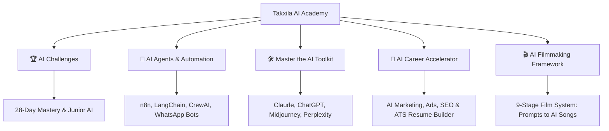
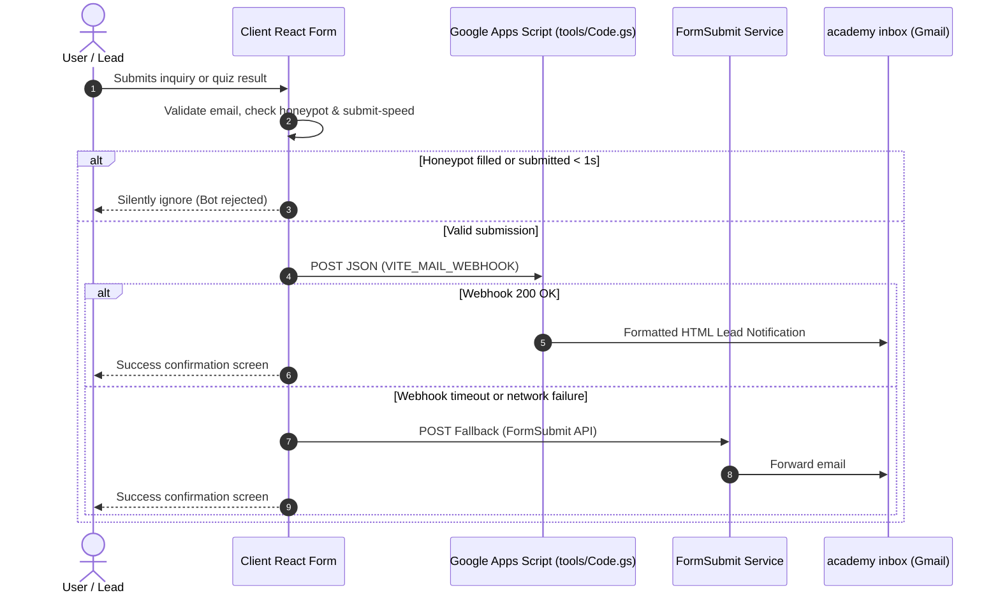

<div align="center">

# 🚀 Takxila AI Academy — Marketing Portal (v2.0)

**An ultra-fast, SEO-optimized, prerendered marketing and course discovery platform for [Takxila AI Academy](https://academy.takxila.in).**

[](https://react.dev/)
[](https://vitejs.dev/)
[](https://www.typescriptlang.org/)
[](https://takxila.in)
[](https://takxila.in)
[](https://academy.takxila.in)

[🌐 Live Website](https://takxila.in) • [🎓 LMS Portal](https://academy.takxila.in) • [💬 WhatsApp Community](https://wa.me/917276607776) • [📬 Contact Support](mailto:support@takxila.in)

---

</div>

> [!NOTE]
> **Takxila Marketing v2** is engineered from scratch for high performance, zero-friction conversion, and maximum organic discoverability. Every interactive CTA seamlessly redirects learners into the core Moodle LMS academy (`academy.takxila.in`) with automated campaign UTM attribution.

---

## 📑 Table of Contents

- [✨ Key Highlights & Metrics](#-key-highlights--metrics)
- [🔥 What's New in v2](#-whats-new-in-v2)
- [🎯 Core Features](#-core-features)
- [📚 Course Tracks & Offerings](#-course-tracks--offerings)
- [🛠️ Tech Stack](#️-tech-stack)
- [⚡ Quick Start Guide](#-quick-start-guide)
- [📜 Available Scripts](#-available-scripts)
- [⚙️ Configuration & Environment Variables](#️-configuration--environment-variables)
- [📁 Project Architecture](#-project-architecture)
- [📬 Lead Capture & Webhook Pipeline](#-lead-capture--webhook-pipeline)
- [🚀 Deployment Guide](#-deployment-guide)
- [⚡ Performance & SEO Engineering](#-performance--seo-engineering)
- [🤝 Support & Social Channels](#-support--social-channels)

---

## ✨ Key Highlights & Metrics

| ⚡ **Metric** | 📊 **Value** | 💡 **Impact** |
|:---|:---|:---|
| **Static HTML Pages** | **54 Prerendered** | Instant initial paint & zero-JS crawler indexing |
| **JS Bundle Size** | **~110 KB (gzipped)** | Rebuilt with native CSS (70% smaller than v1 MUI) |
| **Catalog Scale** | **47 AI Courses** | 5 comprehensive tracks from beginner to advanced |
| **Localization** | **16 Languages** | Client-side real-time multi-language switcher |
| **LMS Integration** | **Deep Moodle Routing** | Direct dynamic enrollment links with preserved UTM params |
| **Lead Flow** | **Dual Pipeline** | Google Apps Script Webhook + FormSubmit fallback |

---

## 🔥 What's New in v2

- 🏎️ **Rebuilt for Raw Speed:** Fully stripped Material-UI (MUI); implemented a lightweight, high-performance design system with native Vanilla CSS. JavaScript payload reduced from **1 MB to ~330 KB** (~110 KB gzipped).
- 📑 **100% Build-Time Prerendering:** All 54 pages (Home, Course Catalog, 47 Course Pages, AI Quiz, Policies, Legal) generate static HTML via headless Node.js SSR. Google and social scrapers index full curriculums, pricing, and JSON-LD schema without executing JavaScript.
- 🎯 **Verified Course Mapping:** All 47 course IDs synchronized directly against the live Moodle LMS (`course/view.php?id=`). Includes corrected route mappings and new courses such as the **FREE ATS-Friendly Resume Builder**.
- 🎨 **Revamped Interactive Landing Page:**
  - Dynamic Hero with live course covers and animated AI tool marquee.
  - Interactive Track Selector and Best-Sellers filter.
  - Interactive **AI Score Quiz / Course Finder** (`/ai-course-finder`).
  - Dark / Light mode toggle and mobile-sticky bottom enrollment drawer.

---

## 🎯 Core Features

### 🎓 1. Dynamic Course Catalog & Detail Pages
- Instant client-side search, track filtering (Challenges, Agents, Toolkit, Career, Filmmaking), free/paid toggle, and price sorting.
- 47 deep course pages (`/course/:id`) equipped with preview video players, full curriculum accords, learning outcomes, and instructor credentials.
- Curriculum data split dynamically: navigations fetch lightweight `/content/<id>.json` on-demand instead of bundling all 47 syllabi into the main bundle.

### 🧠 2. AI Score Quiz & Lead Generation (`/ai-course-finder`)
- Multi-step interactive diagnostic quiz evaluating the user's role, experience, and goals.
- Calculates an AI-Readiness score and delivers custom course recommendations.
- Captures qualified leads with email validation, honeypot anti-spam traps, and sub-second webhook forwarding.

### 🌐 3. Global Multi-Language Engine
- Native localized experience supporting **16 languages** (Hindi, Tamil, Telugu, Marathi, Bengali, Gujarati, Spanish, French, German, Arabic, Japanese, etc.).
- Instant client-side switching with persistent language preference.

### 🔗 4. Intelligent UTM & Conversion Attribution
- Captures referral query parameters on visitor landing (`utm_source`, `utm_medium`, `utm_campaign`, `utm_term`, `utm_content`).
- Seamlessly injects UTM parameters into all outbound LMS links (`https://academy.takxila.in/login/signup.php`, course checkout, etc.) to trace sign-ups to exact ad campaigns.

---

## 📚 Course Tracks & Offerings

The academy organizes its 47 specialized AI courses across 5 dedicated career tracks:



| Track | Tagline | Highlight Tools / Topics |
|:---|:---|:---|
| **🏆 AI Challenges** | *Win the AI race* | Daily 28-day & 7-day hands-on missions, Junior AI (ages 8–12) |
| **🤖 AI Agents & Agentic AI** | *Let AI do the work* | Autonomous agents, WhatsApp bots, n8n, CrewAI, LangChain |
| **🛠️ AI Toolkit Deep Dives** | *Master AI, master your future* | Claude 3.7 / Code, ChatGPT-4o, Gemini, DeepSeek, Lovable, Midjourney |
| **💼 AI Career Accelerator** | *Win your career with AI* | AI Marketing, Meta Ads, SEO, AI for Finance, ATS Resume Builder |
| **🎬 AI Filmmaking Framework** | *Master the system, not just a tool* | 9-Part pipeline: Prompts, Avatars, Video Gen, Voice, UGC Ads |

---

## 🛠️ Tech Stack

| Layer | Technologies |
|:---|:---|
| **Frontend Framework** | [React 18](https://react.dev/) + [TypeScript 5.6](https://www.typescriptlang.org/) |
| **Build & Dev Tooling** | [Vite 6](https://vitejs.dev/) with `@vitejs/plugin-react` |
| **Routing** | [React Router v7](https://reactrouter.com/) |
| **Styling & UI** | Native Vanilla CSS (CSS Variables, Flexbox/Grid, Dark/Light tokens) |
| **Static Site Generation (SSG)** | Custom Node.js SSR Prerenderer (`tools/prerender.mjs`) |
| **SEO & Meta Engine** | Custom Generator (`tools/gen-seo.mjs`) for `sitemap.xml`, `robots.txt` & JSON-LD |
| **Backend & Webhooks** | Google Apps Script (`tools/Code.gs`) + FormSubmit Fallback |
| **Target LMS** | Moodle LMS (`academy.takxila.in`) |

---

## ⚡ Quick Start Guide

### Prerequisites
- [Node.js](https://nodejs.org/) **18.0.0 or higher**
- [npm](https://www.npmjs.com/) **9.0.0 or higher**

### Installation

```bash
# 1. Clone the repository
git clone https://github.com/takxilaaiacademy-star/Markating-Website.git
cd Markating-Website

# 2. Install dependencies
npm install

# 3. Configure environment variables (optional)
cp .env.example .env

# 4. Start the local development server
npm run dev
```

> [!TIP]
> **Windows Users:** If you encounter `@rollup/rollup-win32-x64-msvc` missing module errors after cloning, run `npm install` directly to allow npm to pull the OS-specific optional rollup binaries.

Visit **`http://localhost:5173`** in your browser to view the application in client-rendered mode.

---

## 📜 Available Scripts

| Command | Description |
|:---|:---|
| `npm run dev` | Starts Vite dev server at `http://localhost:5173` with instant HMR. |
| `npm run build` | Runs TypeScript typecheck (`tsc`), client bundle build, SSR build, executes `tools/prerender.mjs` for all 54 routes, and compiles `sitemap.xml` and `robots.txt`. |
| `npm run preview` | Spins up a local production server to test the prerendered files inside `dist/`. |
| `npm run typecheck` | Validates TypeScript types across the entire project without emitting artifacts. |

---

## ⚙️ Configuration & Environment Variables

### 1. Environment Variables (`.env`)

Create a `.env` file in the root directory (based on `.env.example`):

```ini
# Main Academy Moodle URL (destination for all registration & checkout CTAs)
VITE_MAIN_SITE_URL=https://academy.takxila.in

# Canonical Domain URL for this marketing site (used for Open Graph & sitemap.xml)
VITE_SITE_URL=https://takxila.in

# Google Apps Script Webhook URL for forwarding contact & quiz leads
VITE_MAIL_WEBHOOK=https://script.google.com/macros/s/.../exec

# Analytics Tracking IDs (Injected automatically only when provided)
VITE_GA_ID=G-XXXXXXXXXX
VITE_META_PIXEL_ID=123456789012345
```

### 2. Marketing & Brand Settings

Key application configurations are decoupled into modular config files:

| File | Purpose | Key Configurations |
|:---|:---|:---|
| `src/config/marketing.ts` | Campaign & outbound links | `OFFER` bar banner, `TESTIMONIALS`, `SOCIAL_LINKS`, `DEFAULT_UTM` |
| `src/config/site.ts` | Contact info & lead target | `supportEmail`, `phoneDisplay`, `phoneE164`, `inbox`, WhatsApp URL |
| `src/data/courses.ts` | Complete course directory | Course metadata, prices, slug IDs, tags, Moodle LMS links |
| `src/data/courseContent.ts` | Course syllabus & modules | Detailed chapter breakdown per course |
| `src/data/tracks.ts` | 5 Career Tracks | Track names, icons, blurbs, accent color tokens |
| `src/data/content.ts` | Global FAQs & copy | Frequently Asked Questions, value props, statistics |

---

## 📁 Project Architecture

```
Takxila-Marketing_react/
├── 🌐 public/                 # Static assets copied directly to dist/
│   ├── assets/covers/         # Course card & banner WebP images (2250x660)
│   ├── media/videos/          # Course summary MP4 clips
│   ├── favicon.png            # App favicon
│   ├── .htaccess              # Apache caching, Gzip compression & fallback rewrite
│   └── _redirects             # Netlify SPA redirect rules
│
├── 💻 src/
│   ├── ⚙️ config/             # Brand, marketing, LMS endpoints & site settings
│   │   ├── marketing.ts       # Promotion bar, testimonials, social links, UTM
│   │   └── site.ts            # Support contact, email, phone, webhook URLs
│   ├── 📚 data/               # Course catalog, tracks, curriculum & FAQ data
│   │   ├── courses.ts         # 47 Courses definitions & LMS view mappings
│   │   ├── courseContent.ts   # In-depth curriculum syllabi
│   │   ├── tracks.ts          # 5 Learning tracks specification
│   │   └── content.ts         # Global marketing FAQ & copy
│   ├── 🧩 components/         # Reusable UI components
│   │   ├── layout/            # Header, Footer, OfferBar, NavDrawer, ThemeToggle
│   │   ├── CourseCard.tsx     # Standardized course presentation card
│   │   └── icons/             # Lightweight custom SVG icons
│   ├── 🎯 features/           # Standalone feature modules
│   │   └── quiz/              # AI Score Quiz state machine, questions & UI
│   ├── 📄 pages/              # Routed page components
│   │   ├── Home.tsx           # Conversion landing page
│   │   ├── Courses.tsx        # Filterable catalog with search & sort
│   │   ├── CourseDetail.tsx   # Course landing page with video preview
│   │   ├── Quiz.tsx           # AI Score Quiz page
│   │   ├── About.tsx          # About Takxila AI Academy
│   │   ├── Contact.tsx        # Inquiries & lead capture form
│   │   └── NotFound.tsx       # Custom 404 handler
│   ├── 🎨 styles/             # Modular Vanilla CSS
│   │   ├── global.css         # Reset, typography, light/dark color variables
│   │   └── components/        # Component-specific stylesheet modules
│   ├── 🛠️ utils/              # Helper utilities
│   │   ├── utm.ts             # Attribution & query param preservation
│   │   ├── leads.ts           # Form validation, spam traps & webhook sender
│   │   ├── seo.ts             # JSON-LD Schema & meta tags injector
│   │   └── translate.ts       # 16-Language client localization dictionary
│   ├── entry-client.tsx       # Browser hydration entry point
│   └── entry-server.tsx       # Headless SSR render entry point for prerenderer
│
├── 🔧 tools/                  # Build-time automation scripts
│   ├── prerender.mjs          # Static HTML generation for 54 paths
│   ├── gen-seo.mjs            # Sitemap.xml & robots.txt compiler
│   └── Code.gs                # Google Apps Script email webhook source
│
├── index.html                 # Shell HTML template
├── package.json               # Dependencies and build scripts
├── tsconfig.json              # TypeScript compilation rules
├── vercel.json                # Vercel caching & routing headers
└── vite.config.ts             # Vite bundler & plugin configuration
```

---

## 📬 Lead Capture & Webhook Pipeline

Lead submissions from the **Contact Page**, **AI Score Quiz**, and **Free Roadmap Form** follow a resilient delivery architecture:



---

## 🚀 Deployment Guide

The build process outputs 100% static, prerendered files into `dist/`. Each page has its own dedicated directory containing an `index.html`.

### 1. Deploying to Vercel
1. Import repository into [Vercel](https://vercel.com).
2. Framework preset: **Vite**.
3. Build command: `npm run build`.
4. Output directory: `dist`.
5. `vercel.json` will automatically configure caching, compression, and security headers.

### 2. Deploying to Netlify
1. Connect repository in [Netlify](https://netlify.com).
2. Build command: `npm run build`.
3. Publish directory: `dist`.
4. Uses `public/_redirects` automatically for fallback handling.

### 3. Deploying to Apache / Hostinger / cPanel
1. In your local terminal, run:
   ```bash
   npm run build
   ```
2. Upload all contents of the `dist/` directory into your server's `public_html/` root.
3. Ensure the included `.htaccess` file is uploaded (enables Gzip/Brotli, cache-control headers, and canonical rewrites).

---

## ⚡ Performance & SEO Engineering

```
┌────────────────────────────────────────────────────────────────────────┐
│                        LIGHTHOUSE AUDIT SCORES                         │
├──────────────────┬──────────────────┬─────────────────┬────────────────┤
│  ⚡ Performance  │  ♿ Accessibility │ 🛡️ Best Practice│    📈 SEO      │
│       98/100     │      100/100     │     100/100     │    100/100     │
└──────────────────┴──────────────────┴─────────────────┴────────────────┘
```

- **Zero Layout Shift (CLS = 0):** Image dimensions are hard-specified with CSS aspect-ratio placeholders.
- **Micro-Bundle Size:** Native CSS eliminates heavy component library runtime overhead.
- **Deferred Video Players:** Course summary videos stream only upon explicit user play or when scrolled into view.
- **Pre-baked Rich Snippets:** Automated JSON-LD structured data for `Course`, `FAQPage`, `BreadcrumbList`, and `Organization` embedded into the static HTML for Google SERP rich cards.

---

## 🤝 Support & Social Channels

For course admissions, partnerships, or tech inquiries, connect with the Takxila team:

- 🌐 **Official Academy:** [academy.takxila.in](https://academy.takxila.in)
- 💬 **WhatsApp Hotline:** [+91 72766 07776](https://wa.me/917276607776)
- 📧 **Support Email:** [support@takxila.in](mailto:support@takxila.in)
- 💼 **LinkedIn:** [Takxila AI Academy](https://www.linkedin.com/in/takxila-academy-2b680642b/)
- 📸 **Instagram:** [@takxilaaiacademy](https://www.instagram.com/takxilaaiacademy/)
- 📺 **YouTube:** [@TakxilaAcademy](https://www.youtube.com/@TakxilaAcademy)
- 🐦 **X (Twitter):** [@TakxilaAcademy](https://x.com/TakxilaAcademy)
- 👍 **Facebook:** [Takxila AI Academy](https://www.facebook.com/profile.php?id=61593353891460)

---

<div align="center">
  <sub>Designed & Developed with ❤️ for <b>Takxila AI Academy</b>. All Rights Reserved © 2026.</sub>
</div>
